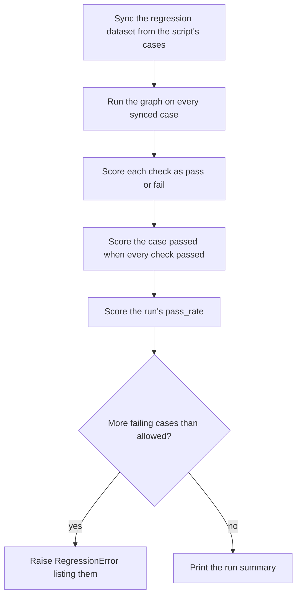

# Experiments

The demo evaluates its graphs as [Langfuse experiments](https://langfuse.com/docs/evaluation/experiments/experiments-via-sdk).
Each experiment is a script in `demo/api/experiments/` that holds its graph's
Git-tracked cases, runs the graph on every case, and scores the results with
code. Every run keeps its traces and scores in Langfuse, where runs can be
compared case by case.

| Experiment | Graph | Cases and checks |
| --- | --- | --- |
| `lgos-rag` | [`lgos-rag`](graphs/lgos-rag.md) | [Evaluate The Graph](graphs/lgos-rag.md#evaluate-the-graph) |

Each experiment has two datasets in Langfuse, with the same case format, so the
same checks score both:

| Dataset | Holds | Edited in |
| --- | --- | --- |
| `<experiment>/regression` | The script's cases, which developers review in Git | The script; each run overwrites edits made in Langfuse |
| `<experiment>/curated` | Cases that testers curate in Langfuse | Langfuse |

## Run An Experiment

```bash
just demo/experiment lgos-rag
```

The recipe runs the script with the API's dependencies and the host gateway's
models, so the gateway must be running. Add `--editable` to use the parent LGOS
checkout. The script prints a line as each case finishes, naming the checks a
failing case missed, then the run's summary.

The script records to Langfuse when `LANGFUSE_PUBLIC_KEY`, `LANGFUSE_SECRET_KEY`,
and `LANGFUSE_BASE_URL` are set, as in `demo/.env`. A fresh Langfuse project
needs nothing else: the first run creates both datasets and every score. Without
the keys, the script runs the same cases and checks on local data with Langfuse
disabled, records nothing, and still fails on too many failing cases.
To run that way with `demo/.env`, add `--no-langfuse`, which also turns off the
API's own tracing:

```bash
just demo/experiment lgos-rag --no-langfuse
```

To run a Langfuse dataset instead of the script's cases, name it with
`--dataset`. The run reads the dataset as it is and writes no cases:

```bash
just demo/experiment lgos-rag --dataset lgos-rag/curated
```

## Curate Cases In Langfuse

Testers add cases to the experiment's `curated` dataset in the Langfuse UI,
without code. Each item's **Input** and **Expected output** follow the case
format of the experiment's page, such as
[lgos-rag's](graphs/lgos-rag.md#evaluate-the-graph). The dataset enforces that
format as a JSON schema, so Langfuse rejects an item that does not match it.
Leave **Metadata** empty.

After a run of the dataset, **Experiments** shows its results. Compare runs,
filter items by their `passed` score, and annotate them with
[human scores](https://langfuse.com/docs/evaluation/evaluation-methods/scores-via-ui).
When a curated case exposes a bug, a developer adds it to the script with the
fix, so the regression cases keep it.

## Judge Answers In Langfuse

Code checks cannot tell whether an answer's content is true. A Langfuse
[LLM-as-a-Judge](https://langfuse.com/docs/evaluation/evaluation-methods/llm-as-a-judge)
evaluator does that without code. Its evaluation rule picks the observations it
scores, such as a graph's answer call in the experiment's datasets, and the
Langfuse worker grades each one after the run. The score and its reasoning
attach to the observation, so a judge never fails a run or counts toward
`passed`. Its prompt lives in Langfuse, where testers can edit it or add
evaluators. Each experiment's page describes its judges, such as
[lgos-rag's](graphs/lgos-rag.md#judge-the-answers).

!!! note "What a judge needs"

    A judge calls its model through a Langfuse LLM connection, with function
    tools for its structured score. A model that supports function tools only
    through the Responses API, such as `gpt-6-luna`, needs the connection's
    **Use Responses API**. The Langfuse worker makes the calls, so a
    self-hosted Langfuse that reaches a private gateway needs the gateway's
    host in the worker's `LANGFUSE_LLM_CONNECTION_WHITELISTED_HOST`.

## What A Run Does



1. The script's cases are the source of truth for the `regression` dataset.
   Each case is named by the script's `case_id`, and the run makes the dataset
   hold exactly them: it adds or updates changed cases and archives removed
   ones. The run also creates the `curated` dataset, and gives both the case
   format's JSON schemas.
2. The Langfuse experiment runner runs the graph on the items the run synced,
   not on a fresh read of the dataset, so a concurrent run of other cases cannot
   swap them. It records each case's graph calls in its trace. A run with
   `--dataset` skips the sync and runs that dataset's items.
3. Each check that applies to a case becomes a `BOOLEAN` score, and the case is
   scored `passed` when it has checks and passes all of them. An evaluator that
   raises, returns anything but checks, or names a check `passed` fails its case
   with a score named after it, holding the error.
4. The run's `pass_rate` is the share of all cases scored `passed`. A case whose
   graph run raised has no scores, so it counts as failed, and its trace holds
   the error. The run's metadata records the evaluator version and the settings
   under test, such as the models.
5. Model sampling flips a case or two between runs, so each experiment allows a
   few failing cases. Beyond that, the run raises `RegressionError` with each
   failing case and its failed checks.

In Langfuse, **Datasets** shows each dataset's cases and their versions, and
**Experiments** shows the runs. Compare two runs to see which cases a prompt,
model, or retrieval change fixed or broke, or filter a run's items by `passed`
to open the failures.

## Add An Experiment

A new experiment, such as `experiments/advanced_graph.py`, is a Langfuse
[experiment script](https://langfuse.com/docs/evaluation/experiments/experiments-via-sdk)
that leaves the dataset sync and the gate to `experiments/_shared.py`:

- Pydantic models for a case's input and expected output. Their JSON schemas
  become the case format of both datasets.
- `ITEMS`: local experiment items, each with an `input` and an
  `expected_output`, and a `case_id(input)` function that names each case
  uniquely.
- A task, `async def task(*, item, **kwargs)`, that validates `item["input"]`
  with the input model, runs the graph on it, and returns what the checks need.
  It receives every item as a local one, hosted or not. Pass the graph a
  Langfuse `CallbackHandler()` in its callbacks, so the item's trace holds the
  graph's calls.
- An evaluator, `def checks(*, input, output, expected_output, **kwargs)`, that
  returns one `score(name, passed=..., comment=...)` per check that applies.
- `experiment(context)`, which returns `run(context, ...)` with the name,
  description, items, `case_id`, models, task, evaluators, failure budget, and
  metadata. Record an `evaluator_version` in the metadata, and change it when a
  check changes, so runs graded differently are not compared.
- `main(experiment, ITEMS)` under `if __name__ == "__main__":`; without
  Langfuse, it runs `ITEMS` locally.

`run` rejects an experiment without cases or with a repeated case ID.
`just demo/experiment advanced-graph` then runs the script.

## Run In CI

The scripts follow the Langfuse experiment runner convention, so the [Langfuse
experiment action](https://github.com/langfuse/experiment-action) can run them
unchanged. Point its `experiment_path` at `demo/api/experiments`: it skips files
that start with `_` and puts the folder on `sys.path`, so `_shared.py` is
imported, not run. Without a `dataset_name`, each script syncs and runs its
regression cases. With one, such as `lgos-rag/curated`, the script runs the
dataset the action loads, at a `dataset_version` that CI may pin. Either way,
the action records the commit, branch, and job in the run's metadata. The
action runs the first `python` on `PATH`, so install the API project, put its
virtual environment first on `PATH`, and set
`should_skip_sdk_installation: "true"`. Give the job the gateway's URL and key
too, because the experiments call real models.

## Future: Start Runs From Langfuse

Testers cannot start a run from Langfuse yet. Langfuse's
[Custom Experiment](https://langfuse.com/docs/evaluation/experiments/experiments-via-sdk)
trigger would close that gap: a dataset page sends a signed webhook with the
dataset's name and a JSON config to an endpoint the team hosts. A small receiver
built from the API image would verify the `x-langfuse-signature` header, reply
at once, and run the script's `experiment(context)` on the dataset's items in
the background, so the UI and the CLI share one implementation. Langfuse does
not document the webhook's payload, so capture a real request before building
it.
