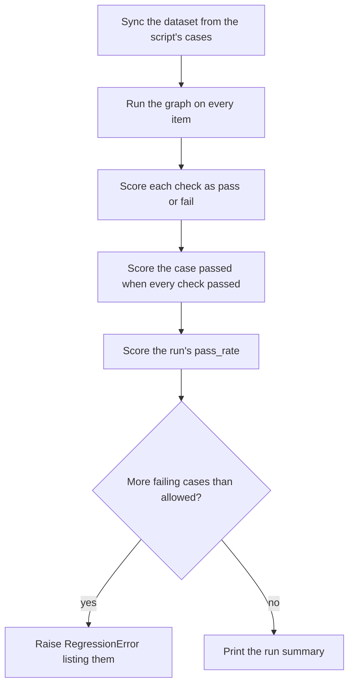

# Experiments

The demo evaluates its graphs as [Langfuse experiments](https://langfuse.com/docs/evaluation/experiments/experiments-via-sdk).
Each experiment is a script in `demo/api/experiments/` that holds its cases, runs
its graph on every case, and scores the results with code. Every run keeps its
traces and scores in Langfuse, where runs can be compared case by case.

| Experiment | Graph | Cases and checks |
| --- | --- | --- |
| `lgos-rag` | [`lgos-rag`](graphs/lgos-rag.md) | [Evaluate The Graph](graphs/lgos-rag.md#evaluate-the-graph) |

## Run An Experiment

```bash
just demo/experiment lgos-rag
```

The recipe runs the script with the API's dependencies and the host gateway's
models, so the gateway must be running. Add `--editable` to use the parent LGOS
checkout.

The script records to Langfuse when `LANGFUSE_PUBLIC_KEY`, `LANGFUSE_SECRET_KEY`,
and `LANGFUSE_BASE_URL` are set, as in `demo/.env`. A fresh Langfuse project
needs nothing else: the first run creates the dataset and every score. Without
the keys, as in CI, the script runs the same cases and checks on local data with
Langfuse disabled, records nothing, and still fails on too many failing cases.
To run that way with `demo/.env`, add `--no-langfuse`, which also turns off the
API's own tracing:

```bash
just demo/experiment lgos-rag --no-langfuse
```

## What A Run Does



1. The script's cases are the source of truth. Each has a stable `case_id` in
   its metadata, and the run makes the hosted dataset, named after the
   experiment, hold exactly them: it adds or updates changed cases and archives
   removed ones. Add cases in the script, not in Langfuse, which each run
   overwrites.
2. The Langfuse experiment runner runs the graph on every item and records its
   calls in the item's trace.
3. Each check that applies to a case becomes a `BOOLEAN` score, and the case is
   scored `passed` when it has checks and passes all of them. An evaluator that
   raises fails its case with a score named after it, holding the error.
4. The run's `pass_rate` is the share of all cases scored `passed`. A case whose
   graph run raised has no scores, so it counts as failed, and its trace holds
   the error. The run's metadata records the evaluator version and the settings
   under test, such as the models.
5. Model sampling flips a case or two between runs, so each experiment allows a
   few failing cases. Beyond that, the run raises `RegressionError` with each
   failing case and its failed checks.

In Langfuse, **Datasets** shows each experiment's cases, and **Experiments** shows
its runs. Compare two runs to see which cases a prompt, model, or retrieval
change fixed or broke, or filter a run's items by `passed` to open the failures.

## Add An Experiment

A new experiment, such as `experiments/advanced_graph.py`, is a Langfuse
[experiment script](https://langfuse.com/docs/evaluation/experiments/experiments-via-sdk)
that leaves the dataset sync and the gate to `experiments/_shared.py`:

- `ITEMS`: local dataset items, each with an `input`, an `expected_output`, and
  a unique `metadata.case_id` that names the case.
- A task, `async def task(*, item, **kwargs)`, that runs the graph on
  `item_input(item)` and returns what the checks need. Pass the graph a
  Langfuse `CallbackHandler()` in its callbacks, so the item's trace holds the
  graph's calls.
- An evaluator, `def checks(*, input, output, expected_output, **kwargs)`, that
  returns one `score(name, passed=..., comment=...)` per check that applies.
- `experiment(context)`, which returns `run(context, ...)` with the name,
  description, items, task, evaluators, failure budget, and metadata. Record an
  `evaluator_version` in the metadata, and change it when a check changes, so
  runs graded differently are not compared.
- `main(experiment, ITEMS)` under `if __name__ == "__main__":`.

`run` rejects an experiment without cases or with a repeated case ID.
`just demo/experiment advanced-graph` then runs the script.

## Run In CI

The scripts follow the Langfuse experiment runner convention, so the
[Langfuse experiment action](https://github.com/langfuse/experiment-action) can
run them unchanged. Point its `experiment_path` at `demo/api/experiments`: it
skips files that start with `_` and puts the folder on `sys.path`, so
`_shared.py` is imported, not run. Leave its `dataset_name` unset, because each
script syncs its own dataset; the action still records the commit, branch, and
job in the run's metadata. The action runs the first `python` on `PATH`, so
install the API project, put its virtual environment first on `PATH`, and set
`should_skip_sdk_installation: "true"`. Give the job the gateway's URL and key
too, because the experiments call real models.
