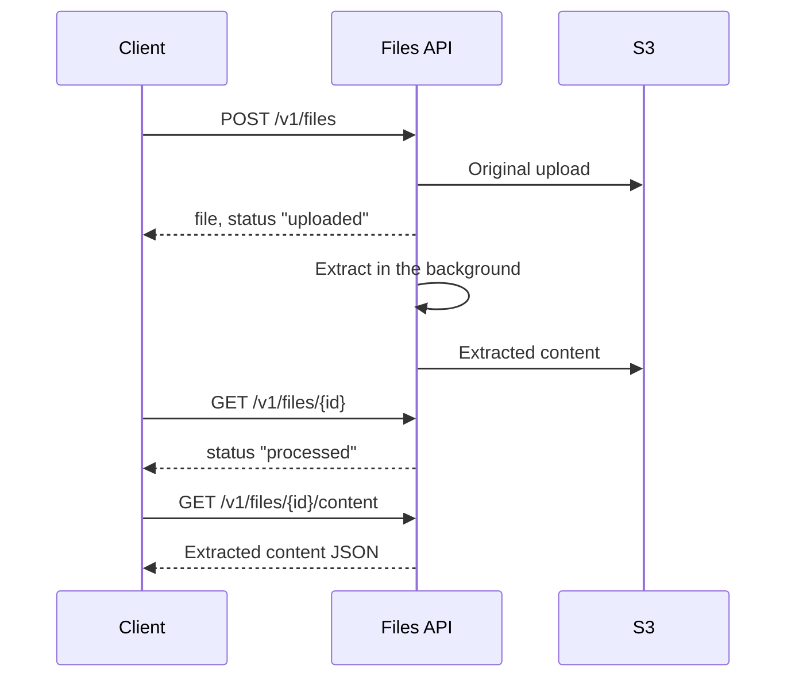

# Run The Files API

The independent `demo/files_api` project exposes an OpenAI-compatible Files API
over S3-compatible storage and extracts the text of uploaded documents. It has
its own package, lockfile, Dockerfile, image, settings, and tests. It does not
depend on `langgraph-openai-serve`, LangGraph, or the demo graph API.

## Run The Service

Configure the `DEMO_API_FILES_*` values in `demo/.env`, then choose one mode:

=== "Local process"

    ```bash
    just demo/files
    ```

=== "Published container"

    ```bash
    just demo/up lgos-files-api
    ```

The OpenAI base URL is `http://localhost:3006/v1`; health is available at
`http://localhost:3006/health`. The bucket must already exist.

The service supports upload, list, retrieve, content, and delete operations for
`purpose="user_data"`. The maintained UIs reach it through Bifrost's
`lgos-files` provider or LiteLLM's `litellm_proxy` Files provider; they do not
connect directly. Direct protocol checks may call it on port 3006. The
`file-input` graph uses the same service to resolve an incoming `file_id`.

## Extract Document Content

After an upload, the service extracts each document's content in the
background and stores it in S3 next to the original:

| Files | Extractor | Content |
| --- | --- | --- |
| `.pdf`, `.docx`, `.doc`, `.pptx`, `.ppt` | [xberg](https://github.com/xberg-io/xberg), OCR included | `{"type": "text", "version": 1, "text": "<Markdown>"}` |
| `.md`, `.txt` | The service | `{"type": "text", "version": 1, "text": "..."}` |
| `.xlsx`, `.xls` | The service | `{"type": "spreadsheet", "version": 1, "sheets": [...]}` |

Each sheet lists its `name`, `headers`, data `rows`, and `chunks`: groups of
rows rendered as `Row N | Header: value` lines for retrieval.



OpenAI reports file processing through its deprecated `status` field, so SDK
clients can wait with `files.wait_for_processing`:

| `status` | Content endpoint |
| --- | --- |
| `uploaded` | `{}` while the document is being extracted |
| `processed` | The extracted content as JSON |
| `error`, with `status_details` | The extraction's error |

`GET /v1/files/{file_id}/content?raw=true` returns the original upload of any
file. Files without an extractor, such as the images and Plotly charts that
graphs generate, always return their original bytes, which the UIs display.

xberg runs in the service process, at most
`DEMO_API_FILES_MAX_CONCURRENT_EXTRACTIONS` documents at once with
`DEMO_API_FILES_EXTRACTION_THREADS` threads, each within
`DEMO_API_FILES_EXTRACTION_TIMEOUT_SECONDS` of getting a slot. Size the threads
to the container's CPU limit: xberg otherwise sizes its pools, and with them its
memory, by the host's cores. Its bundled Tesseract reads pages without a text
layer; the image ships English OCR data only, so no extraction downloads
anything at runtime.

| Failure | `status_details` | Extracted again |
| --- | --- | --- |
| A file the extractors cannot read | `Failed to parse the file.` | No |
| An extraction over its time limit | `Timed out while parsing the file.` | By a retrieve five minutes later |
| A storage or other service error | `Internal Server Error` | By a retrieve five minutes later |
| A document that stopped the service twice, such as by running out of memory | `The extraction did not finish.` | No |

The extraction state lives in S3 next to the files, so a restart loses nothing:
extractions cut short by a shutdown resume at the next start, once. Run one
service process per bucket, because each process resumes every unfinished
extraction.

The service refuses an upload over `DEMO_API_FILES_MAX_UPLOAD_BYTES` once
Starlette has written it to `/tmp`, so keep `/tmp` larger than the limit and
cap request bodies at the gateway or proxy in front of the service. Files stored by versions before content extraction, under
`openai-files/`, are neither listed nor served; this version stores each file
under its ID at the bucket root.

## Ownership Boundary

Only this service receives the `DEMO_API_FILES_AWS_*` credentials and bucket
configuration. LGOS APIs receive only the Files base URL needed by a
graph that resolves IDs. Chainlit's native element-storage credentials remain
separate, and Open WebUI retains its own copy of each upload, with the text
this service extracted, in its data volume.

The demo is a deliberately small reference implementation. Before exposing it
to untrusted clients, add authentication, tenant isolation, retention, malware
policy, and the availability controls required by the
deployment. See [Accept And Display Files](../how-to-guides/file-inputs.md) for the
client and graph flow and [Settings and Commands](reference.md#files-api-settings)
for configuration.
