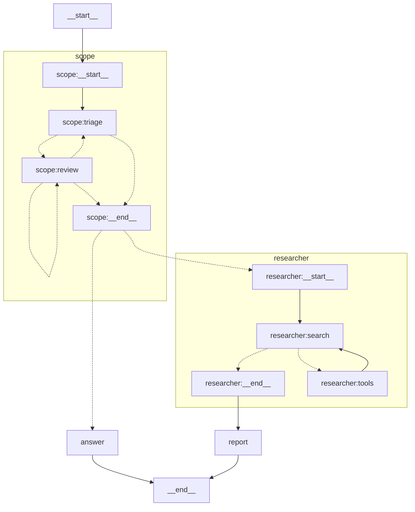
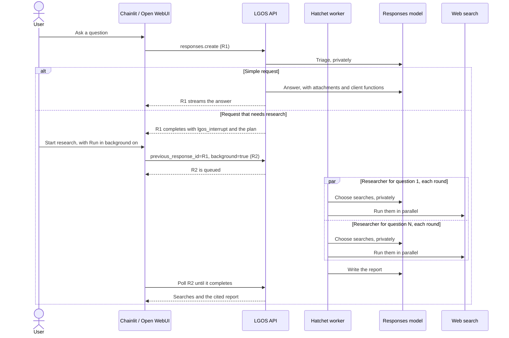

# Deep Research

`deep-research` is the demo's showcase of LGOS features working together in one
model-backed assistant. Users can ask anything. A private triage call answers a
simple request directly; for a question that needs the web, it proposes a
research plan and pauses. The user starts the research, asks for a direct
answer instead, or edits the plan. One researcher per plan question then
searches the web in rounds of parallel queries, and a streamed report cites the
results. Because research can take minutes, the client can resume the pause as
a background Response. Runtime settings let the client skip the plan review or
change how many rounds of searches run. As with OpenAI's API, the client allows
web access by selecting web search; a question that needs research without it
gets a reply asking the user to turn web search on.

The workflow follows the common shape of deep-research products: effort scales
with the question, the user approves a plan before research starts, parallel
researchers each work in a clean context, the long-running work can run in the
background, and the report cites its sources. Both phases before the report are
LangGraph subgraphs added as nodes, so the graph is also the demo's model-backed
[subgraph showcase](#subgraphs).

Clients use the model `deep-research` through `POST /v1/responses`. Chat
Completions rejects it because interrupts require the Responses API. Its
upstream model calls also use the Responses API with `store=false`.

| LGOS capability | How the graph uses it |
| --- | --- |
| `interrupts` | The plan review pauses the run, and the answer resumes it |
| `background` | A client may run any request, including the resume that starts research, in the worker |
| `file_inputs` | Attachments reach triage, the direct answer, and the report |
| `mcp_tools` | UIs attach their gateway MCP tools, which the direct answer can call as client functions |
| `web_search` server tool | Research runs every search as a native `web_search_call` |
| Status | Each search query and the report writing appear as commentary while streaming |
| Citations | Report links to search results become `url_citation` annotations |
| Client settings | **Review plan** and **Research rounds** appear in both UIs' settings |
| Subgraphs | The review pauses inside `scope`, and parallel `researcher` subgraphs stream their progress and return their searches |

## LangGraph Topology

The native `xray` view qualifies subgraph nodes with their subgraph name;
dotted edges are chosen at run time.



- **`scope:triage`** asks the model, through private structured output,
  whether the request needs research and, if so, for three to five
  self-contained research questions. `tool_choice: "none"` and a named function
  skip it and go straight to `answer`. As in OpenAI's API, `required` with only
  `web_search` selected forces a search, so even a simple request is researched.
  With **Review plan** off, the scope ends without the pause.
- **Web search off:** researchers start only when the request that starts them
  selects `web_search`. Otherwise a plan skips the review, and `answer` replies
  that the question needs web research and that turning on Web search starts
  it. This also applies when web search is turned off before **Start
  research**.
- **`scope:review`** pauses with a question that lists the plan. The answer
  chooses what happens next:

    | Answer | Result |
    | --- | --- |
    | `Start research` | The scope ends, and the researchers start |
    | `Answer now` | The scope ends without a plan, so `answer` runs |
    | Other text | An edit: `triage` revises the plan from it and asks again. The edit stays out of the conversation, so `Answer now` still answers the request |
    | Blank | Asks again with the same plan |

- **`researcher`** runs once per plan question, all in parallel. Its `search`
  node asks the model for any number of parallel `web_search` calls, which
  LangGraph's prebuilt `ToolNode` runs in `tools`. A researcher stops when the
  model asks for none or its **Research rounds** are used up.
- **`report`** and **`answer`** are the only streamed model calls. `report`
  starts once every researcher has finished. It uses only the search results
  and the user's messages and attachments: a question the results don't answer
  is reported as unanswered, not answered from the model's own knowledge.
  `answer` binds the client's functions and honors `tool_choice` and
  `parallel_tool_calls`.

## Subgraphs

Both subgraphs are compiled graphs that the parent adds directly as nodes,
LangGraph's [documented way](https://docs.langchain.com/oss/python/langgraph/use-subgraphs)
to use a subgraph that shares state keys with its parent:

| Subgraph | Added as a node with | Receives | Returns | Keeps private |
| --- | --- | --- | --- | --- |
| `scope` | The parent's state schema as its input and output schemas | The conversation | The plan, empty for a direct answer | Its plan edits |
| `researcher` | Its own input and output schemas, once per question through `Send` | One question | Its searches and findings | Its round count |

Each researcher works in a clean context: it receives only its question, never
the conversation or attachments, so attachment content reaches a web query only
through what the plan states. This follows LangChain's subagent guidance and
OpenAI's
[deep research guidance](https://developers.openai.com/api/docs/guides/deep-research)
to keep private data out of web research. The report then reads the
conversation, attachments, and every researcher's searches together.

Both subgraphs compile without a checkpointer, LangGraph's default
per-invocation mode: each call starts fresh and inherits the parent's
checkpointer. A paused review is stored under the scope's checkpoint namespace,
and LGOS resumes it there without rerunning `triage`. LGOS streams status events
from the parallel researchers as they search, and turns the searches each
researcher returns into `web_search_call` items when it finishes. LangGraph's
documentation shows `Send` with plain nodes; a compiled subgraph is a node, and
the graph's tests cover the fan-out. For the same mechanisms without a model,
see [`nested-subgraphs`](nested-subgraphs.md).

## Runtime Settings

The graph publishes two
[runtime settings](../../how-to-guides/langgraph-runtime-settings.md), which
both UIs render as settings controls and send with every request:

| Setting | Default | Effect |
| --- | --- | --- |
| **Review plan** (`review_plan`) | On | Off starts research without pausing for the plan |
| **Research rounds** (`research_rounds`) | 2 | Rounds of parallel searches each researcher runs, from 1 to 5 |

LGOS validates them per request and passes them to the graph together with the
request, as one typed runtime context. Each request carries its own settings, so
the answer that starts research uses the rounds sent with it.

## Request Flow

The diagram shows the headline path: a foreground question, a plan review, and
research resumed in the background worker. `R1` and `R2` label the two Response
IDs of one graph run.



For each request, LGOS validates the Responses input, converts it to LangChain
messages, and passes the request's tools, `tool_choice`, and settings to the
graph as runtime context. Attachments stay Files API IDs in graph state;
`resolve_file_inputs` downloads them only for the calls that read them.

## Background Execution

OpenAI's API makes `background` a request field, so the client, not the graph,
chooses where each request runs. Both maintained UIs apply **Run in background**
to every request, including review answers: enable it before choosing
**Start research**, and the research runs in the independently deployed worker
while the UI polls the Response. With **Review plan** off, the first request
researches in the worker without a pause. The worker builds the same graph with
the API's PostgreSQL checkpointer, so either process can resume a pause.

A background Response carries no commentary and no streamed text. The
completed Response holds the searches and the report. A plan review that a
background request reaches completes with the same `lgos_interrupt` call as a
foreground one. Stop cancels the Response being polled; nothing runs while a
plan waits for review. The
[background interrupt diagram](background-interrupt.md#request-flow) shows the
polling lifecycle, and [Cancellation](background-interrupt.md#cancellation)
covers each stage.

## Output And Failure Behavior

| Graph behavior | Responses representation |
| --- | --- |
| Plan review | Completed Response with one `lgos_interrupt` function call |
| Each search | `web_search_call` with its query, added when its researcher finishes; `failed` when the search raised |
| Search query and report progress | `phase="commentary"` messages while streaming |
| Report or direct answer | `phase="final_answer"` message; tokens stream in the foreground |
| Research needed with web search off | `phase="final_answer"` message asking to turn on Web search |
| Report link to a search result | `url_citation` annotation |
| Client function, such as an MCP tool | `function_call` for the client to run |

A failed search becomes an error result that the researcher can work around,
so one unavailable result does not end the research. If triage returns no
decision, as with a refusal, the request gets the direct answer, where a refusal
appears as native refusal content. Provider and transport failures remain
errors. Citations cover only exact URLs returned by the search tool; see
[Citation ownership](../../explanation/openai-compatibility.md#citation-ownership).

## Persistence And Ownership

| Data | Source of truth | Lifetime |
| --- | --- | --- |
| Conversation and rendered UI elements | Chainlit or Open WebUI | Defined by the client |
| Attachments | Central Files API | Defined by the Files service |
| Paused plan and resume position | LangGraph PostgreSQL checkpointer, under the scope's namespace | Until the run finishes, or `LGOS_INTERRUPT_TTL_MINUTES` |
| Background Responses | Hatchet | Defined by Hatchet |
| Each upstream model Response | Not retained (`store=false`) | One model call |

The graph uses no Store. LGOS gives each run its own checkpoint thread and
deletes it when the run finishes, so search results and the plan last only as
long as the run. A completed conversation stays stateless at LGOS: the client
replays the history it needs, and `previous_response_id` only answers a pause.
See
[Stateless item continuation](../../explanation/openai-compatibility.md#stateless-item-continuation).

## Dependencies

| Path | Required service |
| --- | --- |
| Every request | Responses-capable gateway model, plus the demo PostgreSQL checkpointer and run coordinator |
| Research | The HTTP search endpoint, or the upstream OpenAI Web search, selected by `DEMO_API_WEB_SEARCH_BACKEND` |
| Attachments | Central Files API |
| Background research | Hatchet and the background worker |
| MCP tools | Selected gateway with an MCP server authorized for the UI credential |

??? example "Relevant `demo/.env` values"

    Start from the checked-in `demo/.env.example`. These values select the
    graph's model and search backend:

    ```dotenv
    DEMO_API_OPENAI_RESPONSES_MODEL=openai/gpt-6-luna
    DEMO_API_WEB_SEARCH_BACKEND=openai
    ```

    With `DEMO_API_WEB_SEARCH_BACKEND=http`, set `DEMO_API_WEB_SEARCH_URL` to a
    SearXNG or Degoog JSON endpoint. The
    [settings reference](../reference.md#demo-api-settings) covers every value.

## Try It

With the [complete demo stack](../docker.md#demo-services) running, including
the background services, use either maintained UI:

=== "Chainlit"

    Open `http://localhost:3002`, select `lgos/deep-research`, and enable
    **Web search** in Chat Settings, which also hold **Review plan** and
    **Research rounds**. Before the MCP prompt, open the MCP menu and click
    **Connect** beside `lgos-gateway`.

=== "Open WebUI"

    Open `http://localhost:3003`, select **lgos/deep-research**, and enable the
    **Web search** Chat Variable; **Review plan** and **Research rounds** are
    Chat Variables too. The gateway MCP connection is already selected for the
    model.

| Path | Prompt or action | Expected behavior |
| --- | --- | --- |
| Direct answer | `Explain why idempotency matters in two short paragraphs.` | A streamed answer without a plan review |
| Web search off | Turn off **Web search** and ask the plan-review prompt | A reply asking to turn on Web search, without research |
| Gateway MCP | `How many Chainlit users do I have?` | The UI runs the read-only report through the gateway, and the graph answers from it |
| Attachment | Attach a text file, then ask `Summarize this file.` | A direct answer from the attachment |
| Plan review | `Compare how LangGraph and the OpenAI Agents SDK pause for human approval.` | A review with the plan, **Start research**, and **Answer now** |
| Plan edit | Reply `Only cover resuming after approval.` | A revised plan and another review |
| Background research | Enable **Run in background**, then choose **Start research** | Polling status, then the cited report |
| Review history | Ask `What change did I ask for to the research plan, and what did I choose then?` | A direct answer naming your edit and **Start research**: later requests replay each answered review as its [interrupt call and answer](../../explanation/openai-compatibility.md#resuming-an-interrupt) |
| Settings | Turn off **Review plan**, set **Research rounds** to `1`, and ask the plan-review prompt | Research starts at once and runs one round of searches |

Without **Run in background**, **Start research** streams each search query as
commentary before the report.

### Python SDK

Run the shared [background Python client setup](../api.md#background-python-client)
first. This example asks a research question in the foreground, prints the
proposed plan, and starts the research in a background Response:

```python
import json

model = "deep-research"
tools = [{"type": "web_search"}]

with client:
    pending = client.responses.create(
        model=model,
        input="Compare how LangGraph and the OpenAI Agents SDK pause for approval.",
        tools=tools,
        store=False,
    )
    reviews = [
        item for item in pending.output
        if item.type == "function_call" and item.name == "lgos_interrupt"
    ]
    for review in reviews:
        print(json.loads(review.arguments)["question"])

    report = poll(client.responses.create(
        model=model,
        previous_response_id=pending.id,
        input=[
            {
                "type": "function_call_output",
                "call_id": review.call_id,
                "output": "Start research",
            }
            for review in reviews
        ],
        tools=tools,
        background=True,
    ))
    print(report.output_text)
```

Answer with `Answer now` to skip the research, or with any other text to edit
the plan and receive another review. A simple question completes the first
Response with an answer instead of a review. To start research without a
review, send `metadata={"lgos_settings": json.dumps({"review_plan": False})}`
with the first request. The
[file-input](file-input.md) and
[client-function](core-patterns.md#simple-graph-external-tools) examples show
the request shapes for attachments and client functions; the same fields work
with this model.

The implementation is in
`demo/api/src/lgos_demo_api/graphs/deep_research.py`.
