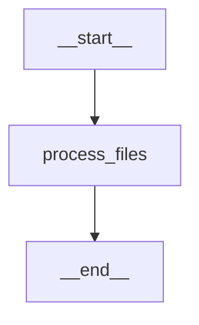
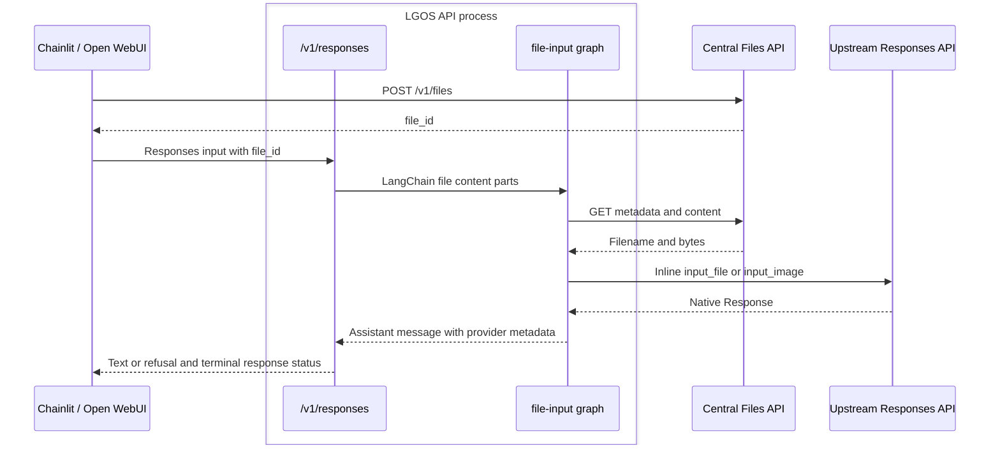

# File Input

`file-input` is a small model-backed graph for trying native Responses
`input_file` and `input_image` parts end to end. It downloads the original
bytes of each central `file_id` and sends them, with any inline images, to the
configured OpenAI Responses API. It has no graph persistence.

## LangGraph Topology



## Request Flow

1. Chainlit and Open WebUI upload attachments through their configured
   `/v1/files` route to the central demo Files service, then place the
   returned IDs in the user message. Chainlit sends every attachment as an
   `input_file` part. Open WebUI uploads only the document and text types the
   service extracts, and its Pipe sends them as `input_file` parts and images
   inline as `input_image` data URLs; Open WebUI injects the text of other
   files into the prompt.
2. LGOS passes those parts to the graph in the LangChain `HumanMessage`: file
   parts and image file IDs by ID, and inline images unchanged.
3. The graph retrieves the filename and original bytes from
   `DEMO_API_FILES_BASE_URL`, asking for `raw=true` content instead of the text
   the service extracts.
4. Images become inline `input_image` data URLs. Other files become inline
   `input_file` data URLs with their original filename.
5. LangChain `ChatOpenAI(use_responses_api=True)` calls the Responses API and
   returns the native assistant message, preserving text, refusals, token usage,
   and incomplete-response details.

The Responses API accepts Base64 data in `input_file` items. Supported parsing
depends on the file type; see the official OpenAI
[file input guide](https://developers.openai.com/api/docs/guides/file-inputs).



## Try It

Run either maintained Compose UI, select `file-input`, attach a supported
document or image, and send a request such as:

```text
Summarize this file in three bullets.
```

The demo downloads and forwards the entire attachment for each request. It is
therefore intended for small files, not retrieval over a large corpus. The
central `file_id` is only a reference, not authorization; production services
must enforce file access and retention at their own boundary.
