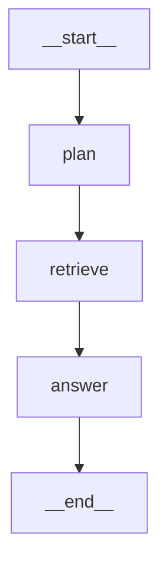
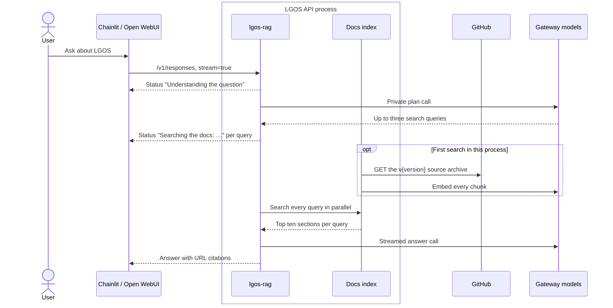

# LGOS RAG

`lgos-rag` is a model-backed documentation assistant that answers questions
about langgraph-openai-serve from the docs of the installed LGOS release. It
searches every docs page and cites the exact sections it used, so answers
describe the release the demo runs.

The graph needs the gateway's chat and embedding models and outbound HTTPS
access to GitHub, which serves the release's docs. It has no checkpointer or
LangGraph Store.

## LangGraph Topology

Every request runs the same three nodes; only the planning call decides what to
search.



## Request Flow



1. `plan` makes one private call with structured output. It first decides
   whether the documentation answers the message, then writes one standalone
   query per distinct part, at most three, resolving references to earlier
   turns. Greetings, thanks, questions about the conversation, unrelated
   requests, and messages too vague to search get no queries. LangGraph's
   `nostream` tag keeps every planning token out of the answer stream.
2. `retrieve` is code only. It publishes a status per query, which streaming
   Responses shows as commentary, searches the queries in parallel, and merges
   the top ten sections of each. With no queries it does nothing, so a
   greeting never loads the index.
3. `answer` is the only streamed call. With sections, it answers from them
   alone and cites them, or asks one clarifying question when the question
   could mean clearly different things. Without sections, it replies briefly,
   asks what a vague message means, or declines.
   Markdown links and bare URLs that exactly match a retrieved section become
   OpenAI `url_citation` annotations, so a citation does not depend on the
   model's link formatting. Other links stay ordinary Markdown.

Both calls run at temperature 0: sampling adds nothing to a documentation answer,
and would vary the searches and answers for the same question.

## Why A Workflow

A tool-calling agent could search too, but for one library's docs the
model's only useful freedom is writing and splitting queries, and one
structured call does that. The fixed graph has a hard limit of two model calls,
a search-or-skip decision that tests can check, a status for each phase, and no
text written beside a tool call to reconcile with the streamed answer.

Five runs of the 57-case evaluation below failed at most one case each, with a
median latency of about 4 seconds per case. Questions whose second
search depends on the first search's results are the case a workflow cannot
handle; add a bounded, opt-in agent mode if evaluation shows them failing.

The graph asks its clarifying questions as ordinary replies, which the next
message answers through the conversation. An LGOS interrupt would pause and
checkpoint a read-only answer for nothing to approve, and declaring
`interrupts` would make the model unavailable through Chat Completions.

## Documentation Index

The graph finds the installed release in the docs site's `versions.json`, which
names each release as its tag does, so a pre-release finds its docs although
Python normalizes its installed version. It indexes the Markdown under `docs/`
in the GitHub source archive of tag `v<release>`, and links every section to the
published docs of that release,
`https://ilkersigirci.github.io/langgraph-openai-serve/<release>/`. The Markdown
keeps tables, code blocks, and links as the docs authors wrote them; the API
reference that the site generates from docstrings is not part of it.

Each page splits at its headings, outside code blocks, and long sections split
into chunks of at most 2,000 characters, after a code block rather than inside
one: a chunk with half an example invites the model to invent the rest, such as
an import of a class the example defines. A section links to its page and the
anchor Python-Markdown's table of contents gives its heading, which is how
Zensical builds the published anchors, including the numbered anchors of
repeated headings. Relative links become docs-site URLs, as they do on the
site, so a link the model copies still works. Each chunk starts with its
heading path, such as `Run The LGOS Server > Settings`, so embeddings, keyword
search, and the model all see where it belongs.

The graph answers only from a tagged release's docs. An unreleased LGOS
checkout, such as the one the `--dev` Compose stack installs, reports the
placeholder version `0.0.1`, because releases stamp their version from the tag.
For it, the graph uses the release that the docs site's `versions.json` marks as
`latest`, so its answers can trail docs changed in the checkout. A release whose
docs are not published yet, or whose archive has no docs, fails the request with
a server error, and the API log says which.

## Client Settings

Clients that support runtime settings show two options; other clients send them
in `metadata.lgos_settings`.

`scope`, shown as **Docs scope**, is `all`, `library`, or `demo` and defaults to
`all`. `library` searches every page outside the Demo Stack section, and `demo`
searches only that section, so a question about an application of your own is
not answered from the demo stack's setup. For example, with `library`, "How do I
put LGOS behind LiteLLM?" finds the proxy guide instead of the demo's LiteLLM
sync page. The scope filters the search itself, and a restricted scope shows in
the status, such as "Searching the library docs: …". When a restricted search
does not answer the question, the answer says so and suggests setting
**Docs scope** to All.

`bm25`, shown as **BM25 keyword search**, defaults to `true`. Embedding search
finds sections by meaning and is weakest on exact names such as
`LGOS_INTERRUPT_TTL_MINUTES`, `GraphError`, or `GraphFeature.BACKGROUND`, so the
graph can also rank sections with BM25 keyword search. Each ranking contributes
its top ten, and reciprocal rank fusion orders them before the top ten are
returned. Only the strongest keyword matches take part: deeper down, pages that
mention every word of a question, such as the docs home page, can outrank the
sections that answer it.

Replaying the 235 sets of queries that the planner wrote in five evaluation
runs, this put an answering page in the results for every part of every
question. Embedding search alone missed 6, five of them for "What does a client
receive when a graph raises GraphError?".

## Lifetime And Failure

The index lives in the API process. Its first search downloads the release
archive, about 2 MB, and embeds about 480 chunks, a few seconds of work and well
under a cent with `text-embedding-3-small`. Later searches reuse it until the
process restarts. If the download or embedding fails, the request fails instead
of being answered from the model's prior knowledge, and the next search tries
again.

The graph keeps no state between requests. Conversation history comes from the
messages the client sends.

## Evaluate The Graph

`demo/api/experiments/lgos_rag.py` evaluates the graph as a Langfuse
[experiment](../experiments.md), with the gateway's models and the published
docs:

```bash
just demo/experiment lgos-rag
```

It holds 57 cases: questions in a user's words, exact names, follow-ups that
need the conversation, multi-part questions, scoped searches, greetings,
unrelated requests, and the reply's shape after a restricted miss, a vague
message, or small talk. Each check that applies to a case becomes a pass or fail
score:

| Score | Passes when |
| --- | --- |
| `route` | The graph searches exactly when the message needs the docs |
| `retrieval` | Each part of the question has an answering page among the retrieved sections |
| `scope` | A scoped case retrieves only sections in its scope |
| `links` | Every Markdown link in the answer comes from the retrieved sections |
| `citation` | The answer cites at least one retrieved section |
| `reply` | A reply-shape case shows the scope hint, asks a clarifying question, or answers small talk, without declining |

A run fails when more than three cases fail. The
[`grounded` judge](#judge-the-answers) also scores each answer's content in
Langfuse, without failing runs. Add a case in the script whenever a
real question goes wrong, and rerun the experiment after changing prompts,
chunking, ranking, or models.

Cases curated in Langfuse use the script's case format. The input is the
conversation, ending with the user's message, and the graph's
[client settings](#client-settings):

```json title="Input"
{
  "messages": [{"role": "user", "content": "How do I put LGOS behind LiteLLM?"}],
  "settings": {"scope": "library"}
}
```

The expected output lists, for each part of the question, the docs pages that
answer it, as paths after the release. The search must find one page of each
part:

```json title="Expected output"
{"parts": [["how-to-guides/openai-proxies/"]], "reply": null}
```

Empty `parts` mean that no page in the scope answers the message, so the graph
must not search. `reply` checks the reply's shape instead: `"clarify"` expects
a clarifying question, `"small_talk"` expects an answer to a greeting, thanks,
or a question about the assistant or the conversation instead of a refusal,
and `"scope_hint"` expects a search of the restricted scope and a reply that
suggests the **Docs scope** All.

### Judge The Answers

The `grounded` [LLM-as-a-Judge](../experiments.md#judge-answers-in-langfuse)
evaluator fails an answer with a fabricated LGOS setting, command, symbol, or
import path, or with a statement that the retrieved sections contradict. Its
rule, `lgos-rag answers in experiments`, picks the `GENERATION` observations
whose metadata `langgraph_node` is `answer` in experiments of
`lgos-rag/regression` and `lgos-rag/curated`, so the judge sees the sections
and the conversation that the answer call saw.

It ignores overstatements and missing caveats: graded twice, the same answers
flipped between verdicts, so a human review of them is more reliable. It uses
`gpt-6-luna`, which failed an import of a class that the docs example defines
and an invented setting, while `gpt-4.1-mini` passed the import.

## Try It

| Path | Prompt |
| --- | --- |
| No search | `Who are you?` |
| One search | `How do I enable Langfuse tracing?` |
| Exact name | `What does LGOS_INTERRUPT_TTL_MINUTES control?` |
| Several queries | `How do I resume an interrupted run in the background, and what does LGOS_INTERRUPT_TTL_MINUTES do?` |
| Follow-up | `How do I enable Langfuse tracing?`, then `How do I point it at a self-hosted instance?` |
| Library scope | Set **Docs scope** to `library`, then ask `How do I put LGOS behind LiteLLM?` |
| Scope hint | Set **Docs scope** to `library`, then ask `What does DEMO_GRAPH_GATEWAY_API_KEY set?` |
| Vague message | `Why is it failing?` |

### Python SDK

With the [demo API client](../api.md#call-a-graph), search only the library
docs, without BM25, for one request:

```python
response = client.responses.create(
    model="lgos-rag",
    input="How do I put LGOS behind LiteLLM?",
    metadata={"lgos_settings": '{"scope": "library", "bm25": false}'},
    store=False,
)
print(response.output_text)
```

The implementation is in `demo/api/src/lgos_demo_api/graphs/lgos_rag.py`.
