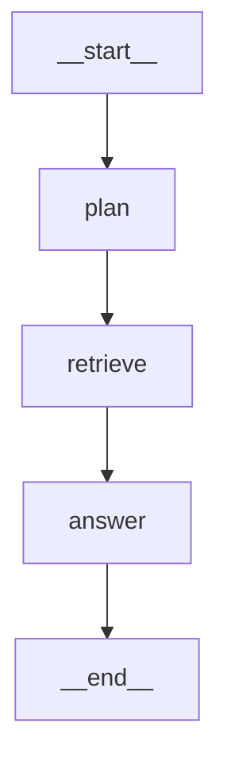
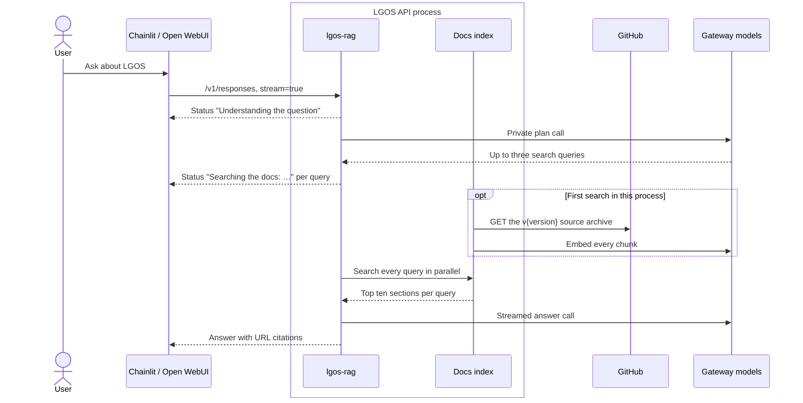

# LGOS RAG

`lgos-rag` is a model-backed documentation assistant that answers questions
about langgraph-openai-serve from the docs of the installed LGOS release. It
searches every docs page and cites the exact sections it used, so answers
describe the release the demo runs.

The graph needs the gateway's chat and embedding models and outbound HTTPS
access to GitHub, which serves the release's docs. It has no checkpointer or
LangGraph Store.

## LangGraph Topology

Every request runs the same three nodes; only the planning call decides what to
search.



## Request Flow



1. `plan` makes one private call with structured output. It first decides
   whether the documentation answers the message, then writes one standalone
   query per distinct part, at most three, resolving references to earlier
   turns. Greetings, thanks, questions about the conversation, and unrelated
   requests get no queries. LangGraph's `nostream` tag keeps every planning
   token out of the answer stream.
2. `retrieve` is code only. It publishes a status per query, which streaming
   Responses shows as commentary, searches the queries in parallel, and merges
   the top ten sections of each. With no queries it does nothing, so a
   greeting never loads the index.
3. `answer` is the only streamed call. With sections, it answers from them
   alone and cites them; without sections, it replies briefly or declines.
   Markdown links and bare URLs that exactly match a retrieved section become
   OpenAI `url_citation` annotations, so a citation does not depend on the
   model's link formatting. Other links stay ordinary Markdown.

## Why A Workflow

A tool-calling agent could search too, but for one library's docs the
model's only useful freedom is writing and splitting queries, and one
structured call does that. The fixed graph has a hard limit of two model calls,
a search-or-skip decision that tests can check, a status for each phase, and no
text written beside a tool call to reconcile with the streamed answer.

Three runs of the evaluation below, when it had 53 cases, failed at most one
case each, with a median latency of about 3.4 seconds. Questions whose second
search depends on the first search's results are the case a workflow cannot
handle; add a bounded, opt-in agent mode if evaluation shows them failing.

## Documentation Index

The graph indexes the Markdown under `docs/` in the GitHub source archive of
the installed release, tag `v<version>`, and links every section to the
published docs of that version,
`https://ilkersigirci.github.io/langgraph-openai-serve/<version>/`. The Markdown
keeps tables, code blocks, and links as the docs authors wrote them; the API
reference that the site generates from docstrings is not part of it.

Each page splits at its headings, outside code blocks, and long sections split
into chunks of at most 1,500 characters. A section links to its page and the
anchor Python-Markdown's table of contents gives its heading, which is how
Zensical builds the published anchors, including the numbered anchors of
repeated headings. Relative links become docs-site URLs, as they do on the
site, so a link the model copies still works. Each chunk starts with its
heading path, such as `Run The LGOS Server > Settings`, so embeddings, keyword
search, and the model all see where it belongs.

The graph answers only from a tagged release's docs. An unreleased LGOS
checkout, such as the one the `--dev` Compose stack installs, reports the
placeholder version `0.0.1`, because releases stamp their version from the tag.
For it, the graph uses the release that the docs site's `versions.json` marks as
`latest`, so its answers can trail docs changed in the checkout. Any other
version without release docs fails the request with a server error, and the API
log names the release archive it could not use.

## Client Settings

Clients that support runtime settings show two options; other clients send them
in `metadata.lgos_settings`.

`scope`, shown as **Docs scope**, is `all`, `library`, or `demo` and defaults to
`all`. `library` searches every page outside the Demo Stack section, and `demo`
searches only that section, so a question about an application of your own is
not answered from the demo stack's setup. For example, with `library`, "How do I
put LGOS behind LiteLLM?" finds the proxy guide instead of the demo's LiteLLM
sync page. The scope filters the search itself, and a restricted scope shows in
the status, such as "Searching the library docs: …".

`bm25`, shown as **BM25 keyword search**, defaults to `true`. Embedding search
finds sections by meaning and is weakest on exact names such as
`LGOS_INTERRUPT_TTL_MINUTES`, `RunBusyError`, or `GraphFeature.BACKGROUND`, so
the graph can also rank sections with BM25 keyword search. Each ranking then
contributes 20 candidates, and reciprocal rank fusion orders them before the
top ten are returned.

On the 0.30.0 docs, both modes put an answering page in the top ten for all 34
single-part evaluation questions. BM25 moved exact names up, such as
`LGOS_INTERRUPT_TTL_MINUTES` from second to first, and some plainly worded
questions down a place or two.

## Lifetime And Failure

The index lives in the API process. Its first search downloads the release
archive, about 2 MB, and embeds about 540 chunks, a few seconds of work and well
under a cent with `text-embedding-3-small`. Later searches reuse it until the
process restarts. If the download or embedding fails, the request fails instead
of being answered from the model's prior knowledge, and the next search tries
again.

The graph keeps no state between requests. Conversation history comes from the
messages the client sends.

## Evaluate The Graph

`demo/api/tests/integration/test_lgos_rag_eval.py` runs 55 cases through
the whole graph with the gateway's models and the published docs of the
installed release. The cases cover questions in a user's words, exact names,
follow-ups that need the conversation, multi-part questions, scoped searches,
greetings, and unrelated requests. Code grades each case:

- a message that needs no docs must not search, and every other message must;
- each part of a question needs an answering page among the retrieved sections;
- a scoped case must retrieve only sections in its scope;
- every Markdown link in the answer must come from the retrieved sections, and
  the answer must cite at least one of them.

```bash
just demo/test-rag
```

Model sampling flips a case or two between runs, so the check allows three
failing cases and prints them. Add a case whenever a real question goes wrong,
and rerun the check after changing prompts, chunking, ranking, or models.

## Try It

| Path | Prompt |
| --- | --- |
| No search | `Who are you?` |
| One search | `How do I enable Langfuse tracing?` |
| Exact name | `What does LGOS_INTERRUPT_TTL_MINUTES control?` |
| Several queries | `How do I resume an interrupted run in the background, and what does LGOS_INTERRUPT_TTL_MINUTES do?` |
| Follow-up | `How do I enable Langfuse tracing?`, then `How do I point it at a self-hosted instance?` |
| Library scope | Set **Docs scope** to `library`, then ask `How do I put LGOS behind LiteLLM?` |

### Python SDK

With the [demo API client](../api.md#call-a-graph), search only the library
docs, without BM25, for one request:

```python
response = client.responses.create(
    model="lgos-rag",
    input="How do I put LGOS behind LiteLLM?",
    metadata={"lgos_settings": '{"scope": "library", "bm25": false}'},
    store=False,
)
print(response.output_text)
```

The implementation is in `demo/api/src/lgos_demo_api/graphs/lgos_rag.py`.
