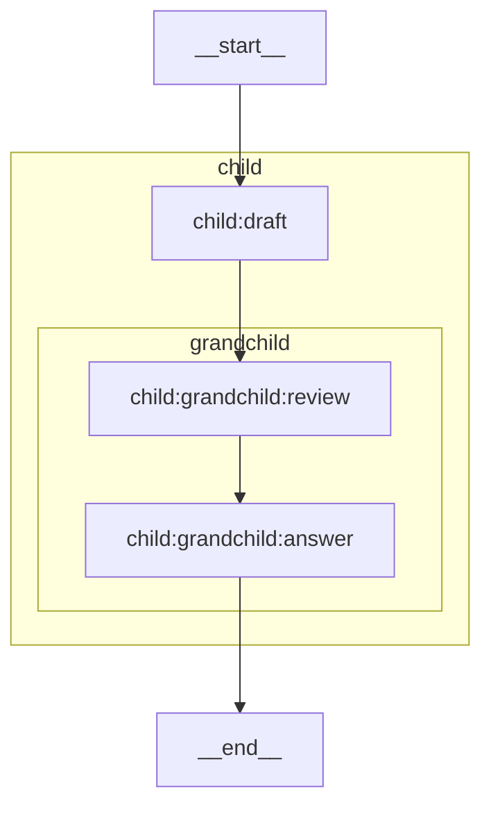
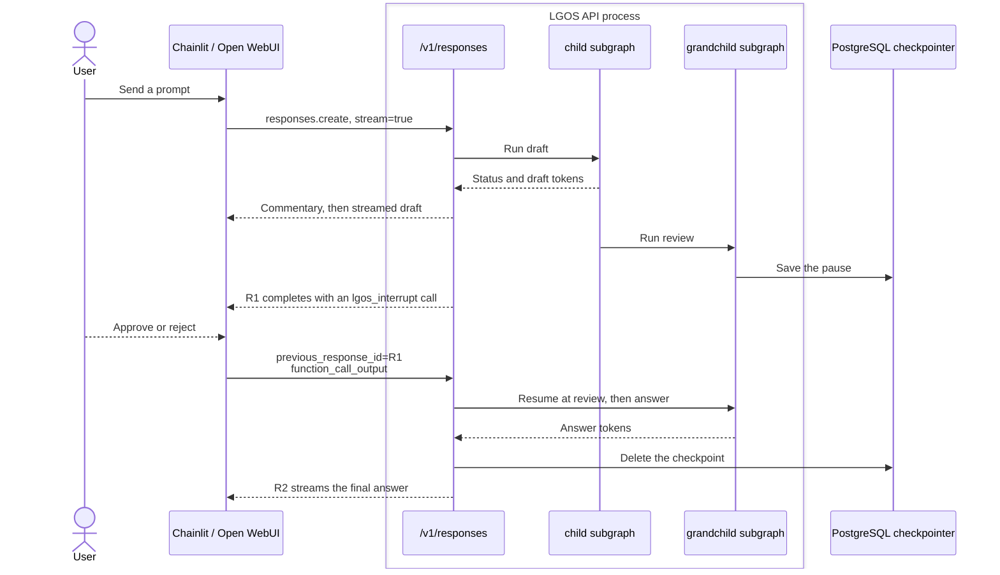

# Nested Subgraphs

`nested-subgraphs` shows that LGOS serves graphs whose work runs inside nested
LangGraph subgraphs. It is a deterministic transport example: a fake chat model
streams fixed text, and the graph calls no provider. One request crosses two
subgraph levels. The child subgraph emits a status and streams a draft, then
its grandchild subgraph pauses for human review and streams the answer after
resumption. The same graph runs in the foreground or in the background worker.

All levels share one state schema whose `messages` channel uses
`add_messages`, so each compiled subgraph runs directly as a node and its
messages reach the root without wrapper code. LGOS's default adapters pass the
request messages in and return the final message, which `answer` writes.

## LangGraph Topology

The native `xray` view qualifies nested nodes with their subgraph path.

## Request Flow

A streaming foreground request pauses in the grandchild, and its answer
resumes there. `R1` and `R2` label the two Response IDs of one graph run.

Each step exercises an LGOS path from inside a subgraph:

| LGOS path | Behavior in this graph |
| --- | --- |
| Token streaming | `draft` runs one level down; its fake-model tokens still stream as answer text. |
| Status | The `status_event()` from `draft` becomes Responses commentary. |
| Interrupt | `review` runs two levels down; its `interrupt()` pauses the whole run, and R1 carries one `lgos_interrupt` call. |
| Resumption | LangGraph reruns `review` with the answer and then runs `answer`; the draft and its status do not repeat. |
| Background | The worker runs the same graph without streaming, pauses at `review`, and resumes there. |

Non-streaming and background requests receive no commentary or draft text: the
paused Response carries only the review call, and the resumed Response carries
the final answer. Chat Completions rejects the model because interrupts require
the Responses API.

The review offers `approve` and `reject` without free text. The graph reports
the answer it receives and takes no action, so either choice finishes the run.

## Persistence And Ownership

The root graph compiles with the API's PostgreSQL checkpointer and declares
`BACKGROUND` and `INTERRUPTS`. The subgraphs compile without a checkpointer and
inherit the root's, which stores their paused state under nested checkpoint
namespaces of the same thread. LGOS deletes the checkpoint after the resumed run
finishes; the demo API deletes runs left paused longer than
`LGOS_INTERRUPT_TTL_MINUTES`.

The API and the background worker register the same graph and share the
checkpointer and run coordinator, so either process can resume a pause. Hatchet
stores background Responses. The graph uses no Store, and the UI owns the
conversation history. For the shared continuation rules, see
[Resuming an interrupt](../../explanation/openai-compatibility.md#resuming-an-interrupt).

## Try It

Select `nested-subgraphs` in [Chainlit](../chainlit.md) or
[Open WebUI](../open-webui.md) and send `Quarterly risks`. The status and
`Draft from the child subgraph: Quarterly risks` appear before the review.
Approve it to see `The grandchild subgraph resumed with: approve`.

To run both legs in the worker, start the background services described in
[Docker Compose](../docker.md#demo-services), enable **Run in background**
before sending, and keep it enabled when answering. The
[Background Interrupt Python SDK example](background-interrupt.md#python-sdk)
also runs this graph with `model = "nested-subgraphs"` and without its
`metadata` setting.

The implementation is in
`demo/api/src/lgos_demo_api/graphs/nested_subgraphs.py`.
