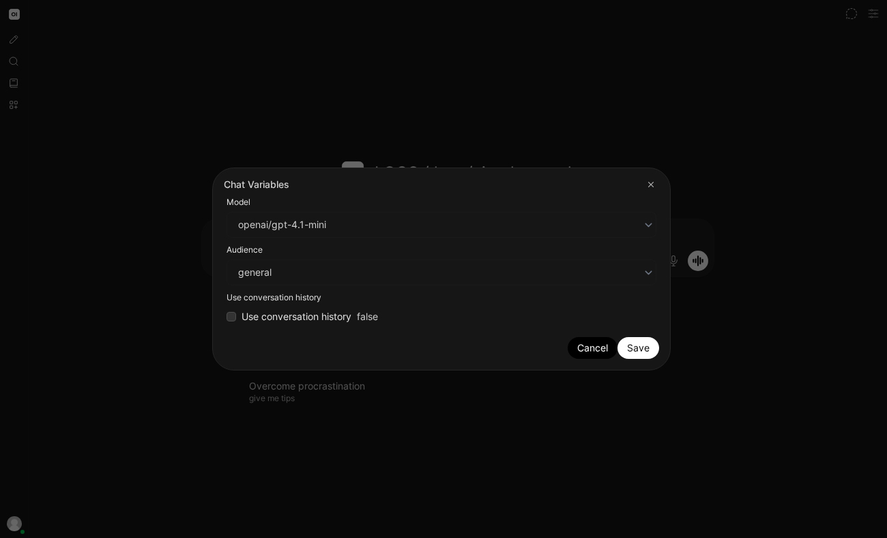
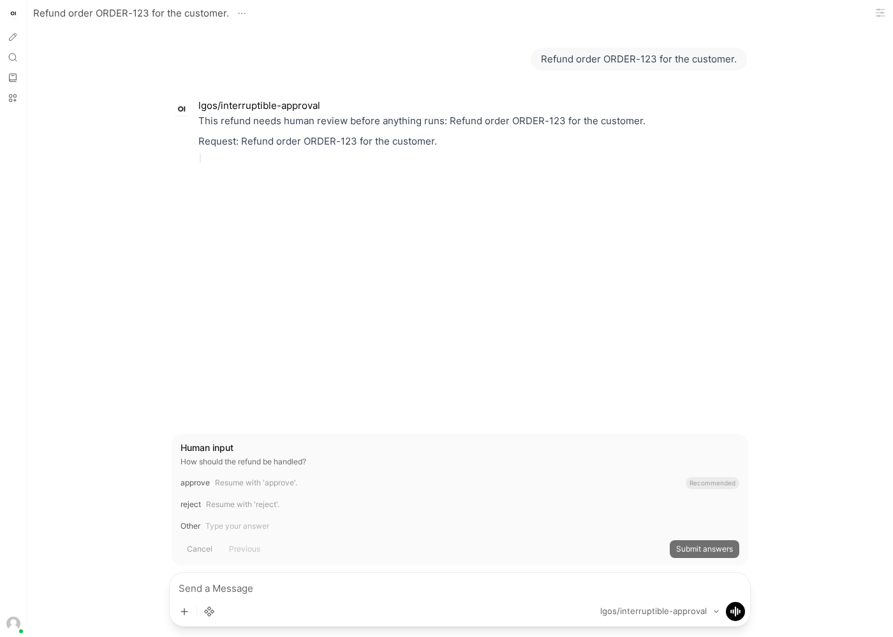

# Open WebUI Integration

Start with **UserValves Simple / simple-graph** to try static per-user runtime
settings. Its small
[`uservalves_simple.py`](https://github.com/ilkersigirci/langgraph-openai-serve/blob/main/demo/ui/openwebui/src/lgos_openwebui/functions/uservalves_simple.py)
Filter declares two settings and passes their values to the shared Responses
Pipe. Open WebUI owns the settings form and persistence.

The demo includes two Open WebUI Functions:

- `functions/uservalves_simple.py` demonstrates a fixed `UserValves` schema
  for one graph, using Open WebUI's native
  [Filter and UserValves support](https://docs.openwebui.com/features/extensibility/plugin/development/valves/).

- `demo/ui/openwebui/src/lgos_openwebui/functions/generic/` is the modular source
  for a
  [manifold Pipe](https://docs.openwebui.com/features/extensibility/plugin/functions/pipe/#creating-multiple-models-with-pipes)
  for all registered graphs. It uses OpenAI Responses, graph-specific runtime
  settings, and the standard Files API, and adapts LGOS
  interrupts to Open WebUI's native question UI.

Each time Open WebUI loads its model list, the Pipe lists every model in its
model namespace (`lgos/` in the demo) in
the gateway catalog together with what Open WebUI shows for it: the graph's
description, its file-upload capability, its gateway MCP tools, and its LGOS
settings as native Chat Variables, which Open WebUI renders as a per-chat form.
Graph changes therefore appear on the next model-list load.
Each server tool the model advertises in `lgos.server_tools` adds a Chat
Variable checkbox labelled from its name, so `server-tool` shows
**Package version** and **Web search**, and `deep-research` shows only
**Web search**; its gateway MCP tools come from its `mcp_tools` feature. The
Pipe maps an enabled box to `{"type":"web_search"}` for `web_search` and to a
name-only `{"type":"custom","name":...}` declaration otherwise, and keeps it
out of `metadata.lgos_settings`. It offers `display_file` only to models that
list it in `lgos.client_tools`. The catalog publishes both lists in the model's
info, where the Pipe reads them at chat time. A question that needs research
triggers the deep-research plan review without a graph-specific setting.
The Pipe executes only native `function_call` items. Server custom calls and
searches have distinct native types and are already complete.
When the sync installs the UserValves example and `lgos/simple-graph` has valid
metadata, the Pipe also lists the example, which runs the same graph.

## Other Gateway Models

Open WebUI's own OpenAI connection points at the same gateway root, with the
Pipe's [credential](#gateway-credentials), so every other model the gateway
serves, such as `openai/gpt-4.1-mini`, appears automatically and uses Open
WebUI's built-in chat. The connection would also list the graphs, as plain
`lgos/<graph>` models without the Pipe's settings form, interrupt cards, and
file handling. Stock Open WebUI hides a connection's models only through stored
model records or a fixed model ID allowlist, which also hides the models the
gateway adds later. The image adds `exclude_model_ids` to a connection's entry
in `OPENAI_API_CONFIGS`: glob patterns matched against the gateway's model IDs
whenever Open WebUI lists models. Compose sets `["lgos/*"]`, so each graph
appears once, as the Pipe's model. Open WebUI also shows the embedding and
speech models the gateway lists for the credential; an admin can switch any of
these models off in Open WebUI's model settings.

## Gateway Credentials

Open WebUI's own OpenAI connection to `${OPENAI_GATEWAY_BASE_URL}/v1` decides
the credential. Its `auth_type` in `OPENAI_API_CONFIGS` applies to its own
model list and chats. The Pipe reads that connection on every request, so its
model catalog, chats, and file uploads send what the connection sends, and
[voice](#voice) follows it because it uses the same gateway URL. Without a
connection to that URL, the Pipe lists no graphs.

| Connection `auth_type` | Browser login | Gateway credential |
| --- | --- | --- |
| `bearer` | Password or OIDC | `OPENAI_GATEWAY_API_KEY` for every user |
| `system_oauth` | OIDC | The signed-in user's OAuth access token |

The demo's `openwebui.yml` uses `bearer` with password login.
`just demo/compose --sso` adds the [SSO overlay](docker.md#sso-overlay), which
switches the connection to `system_oauth` and passes Open WebUI's OIDC login
settings:

```dotenv
DEMO_SSO_ISSUER=https://id.example.com
DEMO_OPENWEBUI_URL=https://webui.example.com
DEMO_OPENWEBUI_OAUTH_CLIENT_ID=YOUR_CLIENT_ID
DEMO_OPENWEBUI_OAUTH_CLIENT_SECRET=YOUR_CLIENT_SECRET
DEMO_OPENWEBUI_OAUTH_SCOPES="openid email profile groups offline_access llm:invoke"
DEMO_OPENWEBUI_OAUTH_AUTHORIZE_PARAMS='{"resource":"https://llm.example.com"}'
```

With `system_oauth`, the gateway applies each user's model permissions,
budgets, and spend: users see only the models it lists for their token, and
every catalog read, chat, and file upload sends that token. A request without
one fails instead of falling back to the shared key. Open WebUI refreshes the
token with the login's refresh token.

The overlay accepts only SSO sign-ins: it hides the password form and turns
off password signup and password sign-in, including through the API. The provider has verified every user, so new users start as
regular users without an approval step, and members of its `admin` group
become Open WebUI admins, as in LiteLLM. The role mapping and Open WebUI's
group sync read the `groups` claim, so keep `groups` in
`DEMO_OPENWEBUI_OAUTH_SCOPES`. To end Open WebUI sessions when users sign out
at the provider, register `${DEMO_OPENWEBUI_URL}/oauth/backchannel-logout` as
the client's back-channel logout URL.

Register `${DEMO_OPENWEBUI_URL}/oauth/oidc/callback` with the provider; the
overlay sets that callback and Open WebUI's `WEBUI_URL` from the public URL, and
the discovery URL from `DEMO_SSO_ISSUER`. As with
[Chainlit's delegated mode](chainlit.md#persistence-and-login), the token's
audience must be the `LITELLM_OIDC_AUDIENCE` the bundled LiteLLM validates.
Set the authorize parameters only for providers that use RFC 8707 resource
indicators.

The SSO overlay also switches the `lgos-gateway` MCP connection to
`system_oauth`, so the gateway decides each user's MCP tools as it does their
models, and no Open WebUI setting holds the shared key. With password sign-in
off, the sync needs an admin's API key. On a new deployment, `just demo/compose --sso`
stops at the sync; sign in as an SSO admin, create an API key in Open WebUI,
set `DEMO_OPENWEBUI_SYNC_API_KEY`, and run `just demo/sync-openwebui`.

!!! note "One model registry for all users"

    Open WebUI resolves chat models from one registry that each user's model
    listing replaces. With per-user lists, a chat can fail with "Model not
    found" when another user who lacks that model listed models last; the next
    model-list load of the chat's user restores it. This is upstream behavior
    for every per-user connection model, not only LGOS.

## Server Tool Switches

Select **lgos/server-tool**, open the Chat Variables control beside the
chat input, and enable **Package version**, **Web search**, or both. The
checkboxes default to off and their values belong to the chat. LGOS executes
the selected tools server-side without a client-tool continuation.

The OpenAI SDK in the pinned Open WebUI image omits
`custom_tool_call_output` from one generated response union. The Function adds
that existing SDK model to the affected response annotations at load time. The
shim is feature-detected, changes no installed package files, and becomes a
no-op when Open WebUI updates to an SDK containing the corrected union.

For **lgos/deep-research**, the same control contains **Web search**, which its
research requires. Search is sent as a standard Responses tool.

## Simple Per-User Settings

After setup below, select **UserValves Simple / simple-graph**. Open
**Controls → Valves**, select **Functions → UserValves Simple**, and choose
`use_history` and `audience`. These preferences belong to the user and apply across chats
using this example. The field definitions are static; their values are editable.

The Filter adds those values to Open WebUI's request metadata as
`lgos_settings`. The shared Pipe sends them unchanged as
`metadata.lgos_settings`; LGOS validates and applies them.
The example has no Chat Variables form, so there is only one settings control.

The Pipe attaches the Filter only to the example's model,
`generic.uservalves_simple`; do not enable it globally. The example depends on
the Generic Pipe for Responses transport. The **lgos/...** models below
demonstrate schema-driven per-chat settings.

!!! info "Select one first-class gateway"

    Set `OPENAI_GATEWAY_TYPE=litellm|bifrost` once for both demo UIs. LiteLLM
    uses managed Responses; Bifrost uses native Responses. Files also use the
    selected gateway's normal route. Metadata comes from LiteLLM's native
    `/model/info` or Bifrost's native `/v1/models` attributes. Neither
    the Function nor Open WebUI connects directly to LGOS.

## Gateway MCP

Compose declares one Streamable HTTP connection, `lgos-gateway`, in Open
WebUI's `TOOL_SERVER_CONNECTIONS` environment variable. The Pipe selects it
by default for each model whose gateway metadata advertises `mcp_tools`. The
Generic Pipe forwards the gateway tools from
Open WebUI's native `__tools__` map through Responses and returns matching calls
to the native tool loop. `mcp-postgres` adds its fixed report allowlist at the
API boundary, while general-purpose graphs can use the gateway-authorized tool
catalog without knowing which MCP servers provide it.

The connection URL is `OPENAI_GATEWAY_BASE_URL` followed by `/mcp`, the
aggregate endpoint both bundled gateways serve, and `OPENAI_GATEWAY_API_KEY` is
its native bearer key; the [SSO overlay](#gateway-credentials) sends the
signed-in user's token instead. That credential determines which MCP tools can
be discovered, while the downstream DBHub token remains private to the gateway.

Open WebUI reads `TOOL_SERVER_CONNECTIONS` on every start. Compose disables
Open WebUI's persistent configuration, so changes made to the connection in
the admin settings last only until the container restarts.

Keep streaming enabled because Open WebUI's native tool middleware consumes the
streamed tool-call shape. The current database example is
[PostgreSQL Through Native MCP](graphs/mcp-postgres.md); see it for the complete
flow and security boundaries, and Open WebUI's official
[MCP documentation](https://docs.openwebui.com/features/extensibility/mcp/)
for its native server administration and access controls.

## Setup

Start the pinned [`homeserver-open-webui`](https://github.com/ilkersigirci/homeserver-docker/tree/main/Dockerfiles/OpenWebUI) image, the official Open
WebUI slim image with small patches for the upstream gaps this page notes.
Compose reads its tag and digest from `DEMO_OPENWEBUI_IMAGE` in
`demo/.env`:

```bash
cp demo/.env.example demo/.env
just demo/up lgos-openwebui --wait
just demo/sync-openwebui
```

!!! info "Slim image"

    The official slim image omits local
    embedding, reranking, speech, and document-extraction models, the headless
    browser, and keyless DDGS search. The demo uses none of them: speech runs
    through the gateway, uploads stay raw for the central Files API, and graphs
    own retrieval and web search. Open WebUI's own Knowledge and Memory
    features need PostgreSQL with pgvector on this image and are not
    configured. Deleting a stored Open WebUI file therefore removes it but
    reports an error while cleaning up the absent vector index.

Compose runs the image unchanged, with a data volume that keeps users, chats,
uploads, and the installed Functions. `just demo/sync-openwebui` installs the
two Functions under `demo/ui/openwebui/src/lgos_openwebui/functions/`, `generic`
and the `uservalves_simple` example, through Open WebUI's API, and
`just demo/compose` runs it once Open WebUI is up. Rerun it after changing a
Function or the gateway settings; Open WebUI needs no restart. The Generic
Function's `function.py` holds its frontmatter, and its modules are flattened
into one executable source string at sync time.

The sync reaches Open WebUI at `DEMO_OPENWEBUI_HOST_URL` and signs in as the
bootstrap admin, or uses `DEMO_OPENWEBUI_SYNC_API_KEY` when it is set. A missing
Function is created and enabled, and changed source is updated; the metadata,
enabled state, and other valves of existing Functions are kept, as are
unrelated Functions. An unchanged sync writes nothing.

The Pipe reads its deployment from valves the sync sets: `OPENAI_GATEWAY_TYPE`
and the root Open WebUI reaches the gateway at, `OPENAI_GATEWAY_BASE_URL`, from
the stack settings; the `lgos` model namespace; and the MCP connection ID. No
valve holds a key: the [credential](#gateway-credentials) comes from Open
WebUI's own connection to that root. The Pipe's `OPENAI_API_TIMEOUT` valve
remains editable in Open WebUI.

### Remote Deployments

The same command installs the Pipe into any Open WebUI that runs a compatible
patched image, such as one on another machine that serves graphs under another
model namespace. The
[standalone project README](https://github.com/ilkersigirci/langgraph-openai-serve/blob/main/demo/ui/openwebui/README.md#sync-a-deployment)
describes its options, credentials, and the Open WebUI settings it expects.

### Gateway Catalog

The gateway catalog must contain the LGOS metadata before it can be shown. For
independently started components, first [sync LGOS model
metadata](litellm-sync.md) when using LiteLLM; Bifrost publishes it with its
[catalog sync](bifrost.md#declarative-model-metadata). The full-stack
`just demo/compose [--dev] [--otel]` variants do this automatically.

LiteLLM's managed `/v1/models` response is not the UI catalog. The Generic
Pipe reads native `GET /model/info` with the
[gateway credential](#gateway-credentials). Entries with
`model_info.lgos` supply descriptions, features, and complete settings;
`model_name` remains the inference ID. No provider allowlist, per-provider
catalog URL, or LGOS fallback is used. Bifrost uses native `/v1/models`, and the
Pipe decodes `additional_attributes.lgos`, a JSON string containing
descriptions, features, and detailed client-settings schemas. Model
descriptions come from each graph's required `GraphConfig.description`.

Choose an entry such as `lgos/simple-graph` to use Chat Variables. Its Open
WebUI model ID is `generic.lgos/simple-graph`. LiteLLM sends the catalog's
`model_name` unchanged for managed routing. Bifrost also receives the
provider-qualified catalog ID unchanged on native Responses and selects the
provider from its prefix.

!!! note "Pinned Open WebUI contract"

    Open WebUI keeps only `id` and `name` from a Pipe's model list. It reads a
    model's description, capabilities, default tools, Filters, and Chat
    Variables form from the model's `info.meta`, which it otherwise fills only
    from a stored model record; upstream keeps it that way
    ([open-webui#23047](https://github.com/open-webui/open-webui/issues/23047)).
    The image keeps the `info` of each `pipes()` entry as the model's info, a
    per-model equivalent of
    [`DEFAULT_MODEL_METADATA`](https://docs.openwebui.com/reference/env-configuration/#default_model_metadata),
    and the Generic Pipe returns each graph's info there. A model saved in Open
    WebUI's model editor replaces that info. The Pipe's models have no
    stored records, which Open WebUI's per-model access control needs, so
    Compose sets
    [`BYPASS_MODEL_ACCESS_CONTROL`](https://docs.openwebui.com/reference/env-configuration/#bypass_model_access_control);
    the gateway's model list for each credential decides instead. The Pipe
    reads the OpenAI connection settings through `get_openai_runtime_config` in
    `open_webui.routers.openai`, an Open WebUI internal without a public
    equivalent. The sync calls the Functions endpoints that Open WebUI's admin
    UI uses, which Open WebUI does not document. After an image change,
    `just demo/test-openwebui` checks both against the running stack.

    Two upstream gaps would otherwise keep the shared key in SSO mode, and the
    [`homeserver-open-webui`](https://github.com/ilkersigirci/homeserver-docker/tree/main/Dockerfiles/OpenWebUI) image closes each with a small patch:

    - Open WebUI calls a manifold's `pipes()` without the user. The image
      passes it the user's OAuth token when it declares `__oauth_token__`, as
      `pipe()` receives it. Keep `ENABLE_BASE_MODELS_CACHE` off: the cache
      lists models once, without a user.
    - Open WebUI's OpenAI speech settings take only a static key. In the image,
      speech authenticates like the OpenAI connection with the same base URL,
      so the SSO overlay's `system_oauth` connection makes it send the user's
      OAuth token instead of the key. Compose gives both the same gateway URL.

    The image build applies its patches with zero fuzz and tests them, so an
    Open WebUI upgrade that breaks one fails there. Before changing the image
    pin, set the dependency pins in `demo/ui/openwebui/pyproject.toml` to the
    versions the new image ships, then run the Open WebUI tests and browser
    checks.

## File Input

Models enable Open WebUI's native file-upload control only when the graph
advertises `file_inputs`. Select `lgos/file-input` in the bundled
demo to process an attachment. In the pinned release,
`__metadata__["user_message"]` lists the files attached to the message that
started this turn, images included. The Generic Function reads each file's
original bytes through Open WebUI's authenticated
`/api/v1/files/{id}/content` endpoint with the caller's credentials, uploads
them with `purpose="user_data"`, and appends the returned OpenAI `file_id` to
the message. It never reuploads historical chat attachments or moves them to
the latest message. Images use `input_file.file_id` too; the current LGOS
Responses subset does not accept `input_image` items.

This local file bridge uses the HTTPX shipped by the pinned Open WebUI runtime;
it will move to HTTPX2 when Open WebUI adopts OpenAI v3.

The model info is the upload-capability boundary; the Pipe does not add a
second remote metadata check to every Responses request.

Compose sends file uploads through the selected gateway's normal `/v1` Files
route. Bifrost assigns the request to `lgos-files`; LiteLLM assigns it to
`litellm_proxy`. Both providers target the central Files API.

Compose sets the image's `ENABLE_FILE_UPLOAD_PROCESSING=false`, so Open WebUI
stores the original bytes of a chat upload without extracting or embedding
their content before the Pipe runs. The model info also disables chat-time
file-context retrieval and the built-in file tools while preserving other
built-in tools, including `ask_user`.

Open WebUI still owns its raw upload copy because its native attachment UI
requires an Open WebUI file record. The central Files API is the only processing
source of truth and owns the separate inference copy referenced by `file_id`.
The setting applies to every chat upload on this Open WebUI instance, not only
to LGOS models.

!!! note "Temporary upstream workaround"

    The pinned Open WebUI release processes chat uploads before a Pipe or Filter
    can run; a Filter can control later retrieval but cannot prevent the
    earlier extraction. The image's temporary `file-upload-processing.patch`
    adds the switch until Open WebUI can keep chat uploads raw natively. See
    the related
    [upstream issue](https://github.com/open-webui/open-webui/issues/12228) and
    the
    [unmerged File Processing capability PR](https://github.com/open-webui/open-webui/pull/27627).

## Voice

Compose configures Open WebUI's native
[speech-to-text and text-to-speech](https://docs.openwebui.com/features/chat-conversations/audio/)
with its `openai` engines. Both engines call the selected gateway's `/v1` audio
routes with `DEMO_AUDIO_STT_MODEL`, `DEMO_AUDIO_TTS_MODEL`, and
`DEMO_AUDIO_TTS_VOICE`, and with the [gateway credential](#gateway-credentials):
`OPENAI_GATEWAY_API_KEY`, or the signed-in user's token with the SSO overlay.
The Pipe and LGOS stay text-only.

- **Voice mode**, the headphones button in an empty chat input, is the
  hands-free loop. Open WebUI ends a turn after two seconds of silence,
  transcribes it, and submits the text to the selected model as a normal chat
  message. It then speaks the answer sentence by sentence.
- The **microphone** button dictates into the input box for editing before
  sending.
- **Read aloud** under an answer speaks it on demand.

Open WebUI always shows these controls to admins, including the demo
account. `USER_PERMISSIONS_CHAT_STT`, `USER_PERMISSIONS_CHAT_TTS`, and
`USER_PERMISSIONS_CHAT_CALL` hide them only from regular users. Without working
speech models, the controls fail with Open WebUI's own error toasts.

In voice mode, Open WebUI adds its own concise-voice-assistant system prompt,
which the Pipe forwards to LGOS like any other system message. Set
`ENABLE_VOICE_MODE_PROMPT=false` on the Open WebUI service to send only the
transcript.

!!! note "Set the audio URLs explicitly"

    Open WebUI does not derive its audio base URLs from any other
    connection setting; without `AUDIO_*_OPENAI_API_BASE_URL`, speech goes to
    `api.openai.com`. The slim image carries no local Whisper engine or voices,
    so both engines must use an external service.

## Limited Functionality

Every model in the Pipe's namespace remains visible when its gateway metadata
lacks a valid `lgos` extension. Its name and description say **Limited functionality**. Standard assistant text may still work; runtime
settings, file-upload controls, and gateway tools are not assumed.

## Runtime Settings

LGOS remains the schema and default-value source of truth. The Pipe uses the
same deliberately small JSON Schema subset as the Chainlit demo:

- boolean with a boolean default becomes a checkbox;
- string enum with a valid string default becomes a selector;
- string with a string default becomes a text input;
- integer with an integer default becomes a number input, keeping its
  `minimum` and `maximum` as bounds;
- nested objects, arrays, non-integer numbers, and unsupported schemas are
  omitted.

Open WebUI stores Chat Variable values on the conversation. Select an LGOS
model, then use the Chat Variables control beside the message input. Since
LGOS supplies defaults for every setting, the form does not block the first
message merely to confirm them.



*Runtime settings of `lgos/simple-graph`, read from the gateway catalog and
rendered as native Open WebUI Chat Variables.*

When a chat has values, the Pipe serializes its Chat Variables and sends them
as `metadata.lgos_settings`. A chat keeps the values of every model selected in
it, so the Pipe sends only the variables the selected model declares. The form
can return checkbox and number values as text, so the Pipe restores them to
JSON booleans and integers. It omits empty values so LGOS applies its defaults,
and LGOS performs the authoritative runtime validation.

Models advertising `background` also receive an opt-in **Run in
background** checkbox. The Pipe keeps this client-owned value out of
`lgos_settings`, polls the non-streaming Response, and publishes native status
events until the normal answer renderer takes over. Interrupt answers follow
the same checkbox.

The shared Pipe maps Open WebUI's stable `chat_id` to
`metadata.conversation_id` on every Responses request, including the UserValves example.
Langfuse can therefore group the
chat's independent request traces into one session, while Open WebUI continues
to own and resend the conversation history. The generic Pipe also sends the
user's OIDC subject, or Open WebUI's user ID without SSO, as the standard OpenAI
`safety_identifier`; `persistent-plot-agent` uses
both values to scope its chart document. Interrupt resumes reuse the same
conversation value. See the
[persistent plot agent ownership flow](graphs/persistent-plot-agent.md#ownership-boundaries)
for the API Store and Open WebUI persistence boundaries.

## Streaming, Status, And Citations

The general manifold Pipe uses OpenAI Responses for every model. The SDK stream
manager owns event accumulation and supplies the terminal `Response`; the Pipe
adapts final-answer deltas to Open WebUI's native stream interface and maps
completed commentary messages to native status history. It translates standard
answer URL annotations from the completed Response into persistent native
source events, with each cited span as the source excerpt. The SDK owns the
complete annotation objects; the Pipe does not rebuild them from deltas.
Both modes exclude commentary and accept answer messages without the optional
`phase` field. Transcript replay labels assistant answers as `final_answer` and
preserves explicit phase values, following OpenAI's
[assistant phase guidance](https://developers.openai.com/api/docs/guides/reasoning#phase-parameter).
Inline citation markers remain part of assistant content.

Status descriptions remain active while the Responses/tool loop runs and are
finalized when it completes or stops, using Open WebUI's native
[`status` events](https://docs.openwebui.com/features/extensibility/plugin/development/events/#status).
Both response modes display native refusals. Failed and incomplete streaming
events are handled directly so their reason remains visible; incomplete
responses never trigger client functions.

The persistent plot graph returns a standard `display_file` function call. The
Pipe downloads the Plotly JSON through the OpenAI Files API and embeds the
figure in a small HTML document. The browser renders it with the native
[`Plotly.newPlot`](https://plotly.com/javascript/plotlyjs-function-reference/#plotlynewplot)
API; the Open WebUI backend needs no Python Plotly package.
It emits the native persistent [`embeds` event](https://docs.openwebui.com/features/extensibility/plugin/development/events/#embeds-or-chatmessageembeds)
to render an interactive chart in Open WebUI's sandboxed iframe, then returns
the matching `function_call_output` before requesting the final answer.
The HTML uses Plotly's versioned CDN script, so browsers must be able to reach
`cdn.plot.ly`. Open WebUI saves the embed with the message for chat reloads;
HTML and chart bytes stay out of the upstream model transcript. Image files
still use authenticated Open WebUI file storage and the native `files` event. Each continuation retains the original input, including instructions
and file references, then appends complete Response output items and matching
tool results. Final-answer text from every call is retained in both modes.

Server custom call/result items have already been executed by LGOS; the Pipe does
not execute them or send another result. The chat displays their final assistant
answer.

The Pipe returns plain text for non-streaming answers and yields Chat
Completions chunk objects for streamed text. Open WebUI JSON-encodes these
chunks, so literal text such as `data: [DONE]` cannot be mistaken for a stream
event.
Open WebUI owns stream termination. The native `ask_user` bridge also uses the
host's tool-call dictionaries to persist question cards and submit answers.
These shapes belong to the UI boundary; inference uses Responses exclusively.
See the pinned
[Pipe host](https://github.com/open-webui/open-webui/blob/main/backend/open_webui/functions.py).
Shared prompts and graph behavior are documented under
[Events And Citations](graphs/events-and-citations.md#try-it) and
[Persistent Plot Agent](graphs/persistent-plot-agent.md#try-it).

## Interrupt Input

The Pipe translates each LGOS `lgos_interrupt` batch into one built-in
Open WebUI `ask_user` call. Open WebUI persists that pending call on the saved
assistant message, so its native question card survives a page reload. The
`ask_user` call ID carries the paused Response ID, and each question ID is an
LGOS interrupt call ID; answering the card needs no adapter database or live
socket callback.

The deliberately small UI profile is an object containing a non-empty
`question`, two or three unique string `choices`, and optional boolean
`allow_other`. When `allow_other` is true, Open WebUI adds its free-form
**Other** input. This is a demo-client presentation convention, not an LGOS
payload restriction. Responses carries each resume value as a string: the
chosen option's label or the free-form text. Open WebUI trims option labels and
truncates them to 80 characters, so the Pipe rejects choices it would change.

The `question` is everything the reviewer reads: the graph writes its details
into it, such as the [deep-research](graphs/deep-research.md) plan as a list.
Other payload fields are data for API clients, and the Pipe does not display
them. Open WebUI's card shows its text as one plain line and truncates it to 500
characters. So, as a model using `ask_user` would, the card asks the question's
first paragraph, and the rest goes above it as Markdown text. A first paragraph
the card cannot show goes above it too. Once answered, the card folds into
Open WebUI's **View Result from ask_user**, and the text stays in the
conversation.

After the user answers, the Pipe sends the Response ID from the card as
`previous_response_id` with one `function_call_output` item per answered
question. LGOS rejects the resume unless the answers cover its complete pending
interrupt set. One native `ask_user`
call can contain one to three questions, matching Open WebUI's built-in limit.
LGOS itself remains generic and can expose larger atomic batches to clients that
support them.

Later requests replay an answered card as a stateless Responses client replays
any function call: the text above it as assistant text, then one
`lgos_interrupt` call per question with the card's question and choices, then
the answers, so the graph sees what was asked and answered. A cancelled card
never resumed the graph, so only its text replays.

!!! note "Saved chats restore pending input"

    Open WebUI's built-in `ask_user` persistence requires a saved chat. Refreshing
    the page restores the unanswered card; the LangGraph checkpoint remains
    pending until the answer reaches LGOS. **Cancel** ends the Open WebUI turn
    without resuming the graph, so its checkpoint remains pending until the demo
    API's [expiry](graphs/interruptible-approval.md#postgresql-runtime) deletes it.

The refund demo offers **approve**, **reject**, and a custom response. Approval
executes the simulated refund and notification, rejection stops the workflow,
and custom text is returned as reviewer feedback without executing an action.



*Open WebUI renders the interrupt as a native `ask_user` card with choices and
an optional free-form answer.*

LGOS still owns the pending graph checkpoint and its retention policy. See
[Interruptible Human Review](graphs/interruptible-approval.md#postgresql-runtime)
for server-side checkpoint retention.

See the core [citation contract](../explanation/openai-compatibility.md#citation-ownership)
and [interrupt protocol](../explanation/openai-compatibility.md#tool-calls-and-interrupts)
for the API behavior beneath the adapter.
